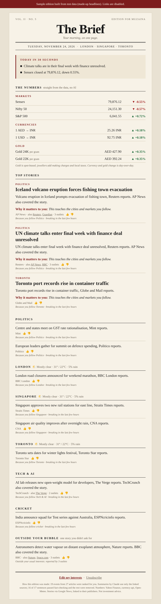

# The Brief

**A personal morning newspaper built on event understanding, a two-stage recommender and grounded generation.**
One email, at the time each reader picks, with their markets, currencies, gold, politics, cities and topics, edited down to a five-minute read.

**[Project page](https://muzz909.github.io/the-brief)** · [PRD (PDF)](docs/prd.pdf) · [70-second video](docs/the-brief.mp4) · [Setup](SETUP.md)



## The four hard problems, and what this repo does about them

| Problem | Approach | Where |
|---|---|---|
| **What is an event?** 40 headlines can be 6 stories | Embeddings (bge-small via fastembed) + online clustering with a tunable threshold, nightly-style merge pass, story memory across days | [`events.py`](brief/events.py) |
| **What matters to *this* reader?** | Two-stage recommender: retrieval by per-section interest vectors → 6 interpretable features → MMR diversity; per-section Thompson-sampling bandit; Rocchio updates from 👍/👎 and clicks; "outside your bubble" exploration slot; explanations generated from the features | [`ranker.py`](brief/ranker.py) |
| **Can you trust the AI?** | Claude writes from a cited source pack; a deterministic numbers check and a second model as claim verifier drop anything unsupported; market numbers never pass through a model; headlines treated as untrusted input | [`writer.py`](brief/writer.py) |
| **Does it ship every day?** | Idempotent sends, per-section fallbacks, headlines-only mode if the model is down, event-driven dispatch with an hourly safety net | [`pipeline.py`](brief/pipeline.py), [workflow](.github/workflows/brief.yml) |

## Architecture

```
v1 Apps Script (front door)            v2 Python on GitHub Actions (the brain)
──────────────────────────            ─────────────────────────────────────────────────────────
Settings page + Google Sheet  ──API──► INGEST      Google News RSS for every feed any reader follows
"Describe your morning" (Claude)       UNDERSTAND  embed → cluster into events → tag (Claude Haiku)
Votes 👍/👎 · Clicks (Pages beacon)     PERSONALIZE interest vectors → score → bandit → MMR → bubble
Every 15 min: who is due? ──dispatch─► WRITE       event summary once per event (Claude Sonnet, cached)
                           ◄──sent──── VERIFY      numbers check + claim verifier (Claude Haiku)
                                       DELIVER     render → Gmail → log impressions (state branch, SQLite)
```

Shared work (fetching, clustering, summaries) runs once per event, not once per reader, so cost grows with the news, not with readers × news.

## Evaluation

- **Offline, on every change** ([`evals/run_evals.py`](evals/run_evals.py), [CI](.github/workflows/evals.yml)): clustering P/R/F1 across a threshold sweep, nDCG@5 for v2 vs a baseline ranker, residual hallucination rate from an independent judge, judge-vs-human Cohen's κ, loaded-language rate in politics. A regression gate fails the build if quality drops.
- **Online:** team-draft interleaving of v2 against a v1-style baseline inside each edition; clicks and 👍 are credited to the ranker that contributed the story; a sign test over reader-days ([`experiment.py`](brief/experiment.py)). Designed for fewer than 10 readers, where an A/B test between people would be underpowered.

## Run it

```bash
pip install -r requirements-dev.txt
python -m pytest -q                       # 18 offline tests (fake network, fake model)
python -m evals.run_evals --embedder hash # eval suite on the bundled sample snapshot
node apps_script/test/harness.js          # 49 checks on the Apps Script side
```

Going live: [SETUP.md](SETUP.md).

## Repo map

| Path | What |
|---|---|
| `brief/` | the pipeline: `config` · `store` (SQLite) · `feeds/` · `embed` · `events` · `ranker` · `writer` · `render` · `send` · `pipeline` · `experiment` |
| `evals/` | eval harness, sample snapshot, labelling templates, baseline |
| `tests/` | offline test suite with fake network and fake model |
| `apps_script/` | v1 front door: settings page, reader API, click beacon, GitHub dispatch, plain-English settings |
| `docs/go.html` | click-tracking redirect on GitHub Pages |
| `.github/workflows/` | `brief.yml` (pipeline), `evals.yml` (tests + eval gate) |

## Decisions worth knowing

- **The LLM writes, it never ranks.** LLM ranking would cost readers × candidates calls, vary run to run, and could not learn or explain itself.
- **No learned ranking model yet.** With under 10 readers there isn't enough signal; every impression is logged with its features so one can be trained later.
- **Headlines and publisher descriptions only.** No full-text scraping; every story links to its publisher.
- **Explanations come from the ranker, not the LLM**, so "Why am I seeing this?" is always true.

Not investment advice. Sample screenshots use made-up headlines.
